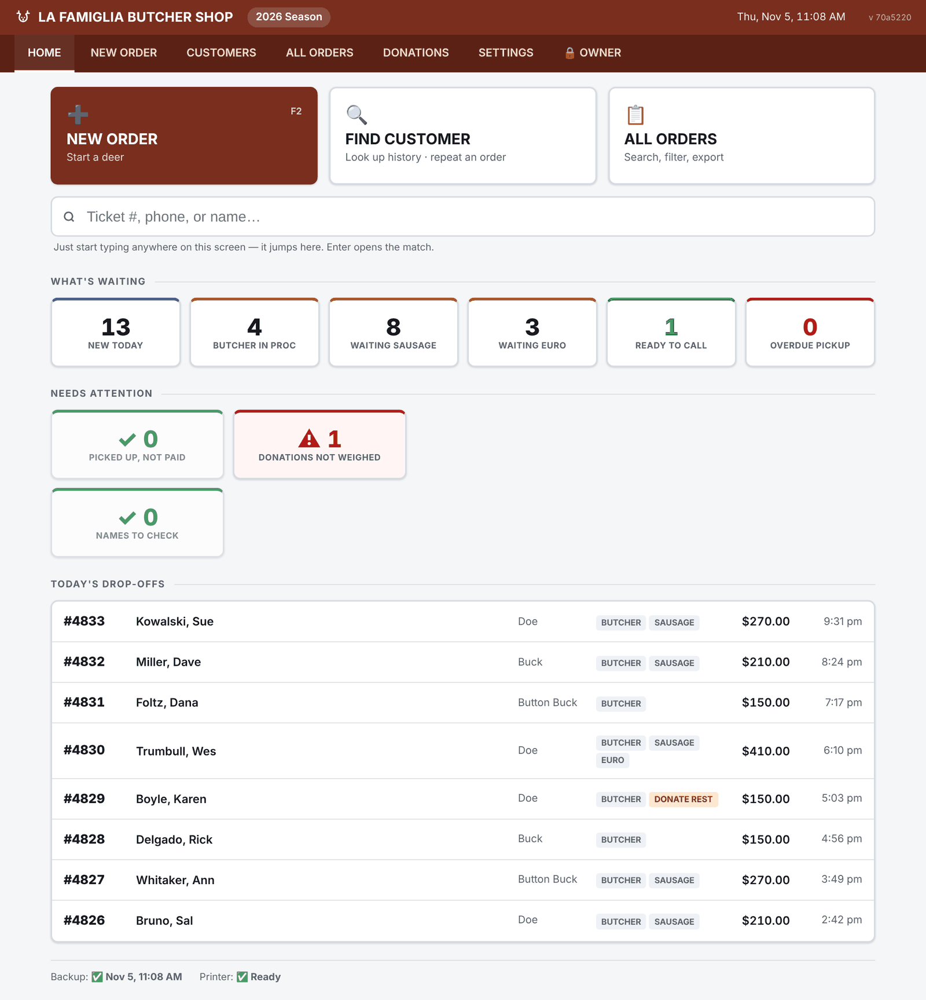

# Deer Processing System — design docs and change history

An order system for a family butcher shop's venison processing season, built by one engineering
leader with AI coding tools. This repository holds the design documents and the full change
history. The application code is private.

## The story in one paragraph

The shop takes in about 1,000 deer between September and February, with one or two people
entering orders. Orders lived on a paper form and a shared Excel file that kept getting
overwritten. Requirements came from a 20-minute sit-down with the owner and notes scribbled on
that paper form, turned into a product requirements document with ChatGPT. Claude turned the
requirements into the design documents here, the shop answered two rounds of questions, and the
first working version was built in one evening on August 16, 2026. It went live in the shop on
day three. It then took 62 commits and 22 database migrations over the next 12 weeks to handle
what the first version didn't know about the business.

## What's here

| | |
|---|---|
| [DESIGN.md](DESIGN.md) | The summary: what it is, what changed from the plan, what's still on the list |
| [docs/01](docs/01-architecture-and-stack.md) | Architecture & stack — one Node.js process, SQLite, zero dependencies |
| [docs/02](docs/02-database-schema.md) | Database schema |
| [docs/03](docs/03-screens-and-flows.md) | Every screen, with screenshots |
| [docs/04](docs/04-rules-status-pricing.md) | Validation rules, status model and pricing |
| [docs/05](docs/05-printing.md) | Printing on a 4×6 thermal label printer |
| [docs/06](docs/06-backup-and-deployment.md) | Backup, recovery and deployment |
| [docs/07](docs/07-edge-cases-and-roadmap.md) | Edge cases, what reality added, roadmap, design decisions |
| [docs/08](docs/08-donation-reimbursement.md) | Venison donation tracking and the New York State HPNAP form |
| [CHANGELOG.md](CHANGELOG.md) | Every commit, newest first |

The docs are kept current with the code; each says what's built, what differs from the original
plan, and what isn't built yet.

## About the data

**Every screenshot uses made-up demo data.** Customer names, phone numbers (all 555), tag
numbers and the shop's address and phone are placeholders. No real customer information appears
anywhere in this repository.

## Context

Deer populations across much of the Northeast exceed what the land supports, and New York State
manages the herd through a regulated, tagged harvest. Shops like this one turn that harvest into
food, and donated venison reaches food banks through the state's HPNAP program. This project is
about the software side of that work: a small, seasonal, home-grown business getting its own
application.
