# 3. Screens, Navigation & Order-Entry Flow

*Current as of November 5, 2026. Every screenshot uses made-up demo data from
`scripts/seed-demo.js`; names and 555 phone numbers are not real customers.*

## Navigation

Seven tabs, always visible, never collapsed into a menu:

**HOME · NEW ORDER · CUSTOMERS · ALL ORDERS · DONATIONS · SETTINGS · 🔒 OWNER**

The header always shows the shop name, the active season, the date and time, and the running
version. The season matters most in January, when it's the difference between filing a deer
under the 2026 season and losing it in 2027.

| Key | Action |
|---|---|
| `F2` | New order, from any screen |
| `F3` | Focus the screen's search box |
| `F4` | Save the order (on New Order) |

On Home, typing anywhere jumps into the search box, so an employee holding a ticket types the
number and presses Enter.

---

## Screen 1 — HOME

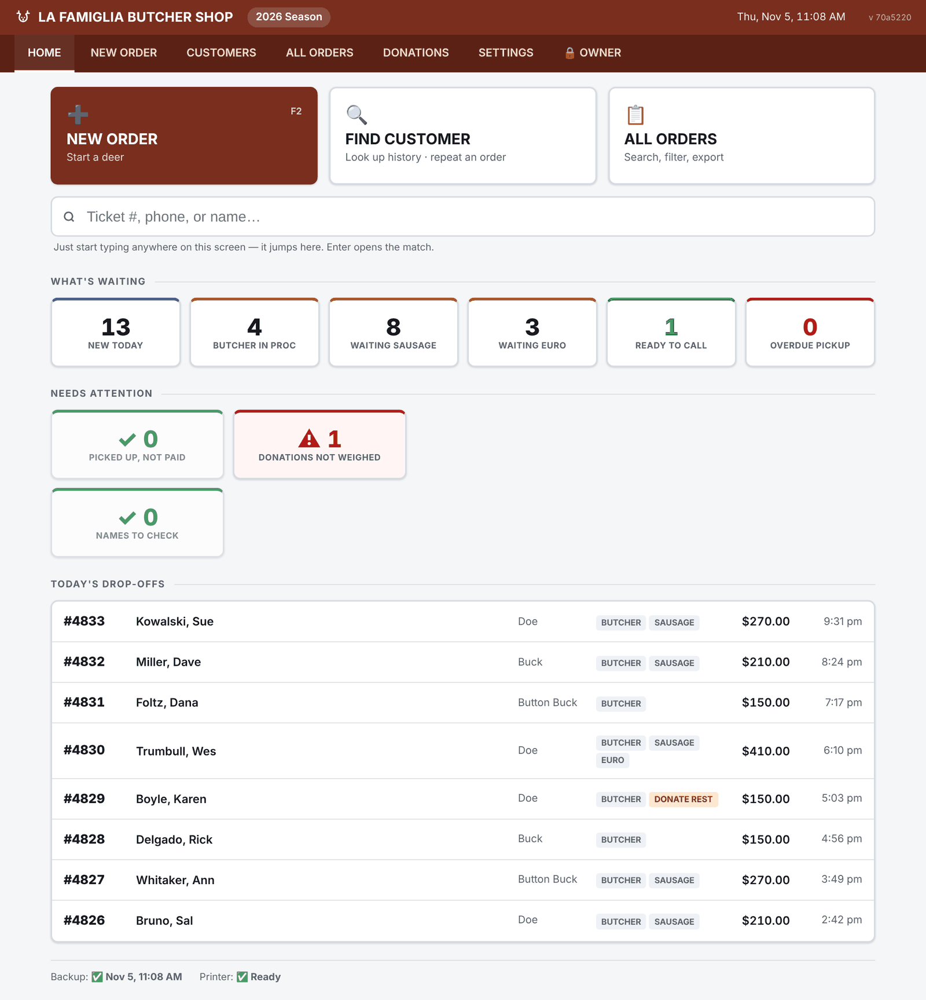

- **What's waiting** — six tiles, each a one-tap link into ALL ORDERS pre-filtered: New today,
  Butcher in process, Waiting sausage, Waiting euro, Ready to call, Overdue pickup.
- **Needs attention** — three tiles that should read zero on a good day, shown as a green ✓ when
  they do: *Picked up, not paid*, *Donations not weighed*, and *Names to check*.
- **Today's drop-offs** — the day's tickets with services and totals.
- **Status bar** — the last backup time, or a warning if the last backup failed.

Two honest limits: the **Overdue pickup** tile always reads 0, because the pickup clock that
would drive it isn't built (doc 7), and the **Printer** indicator always reads Ready; it isn't
connected to the printer.

The page refreshes itself every minute.

---

## Screen 2 — NEW ORDER

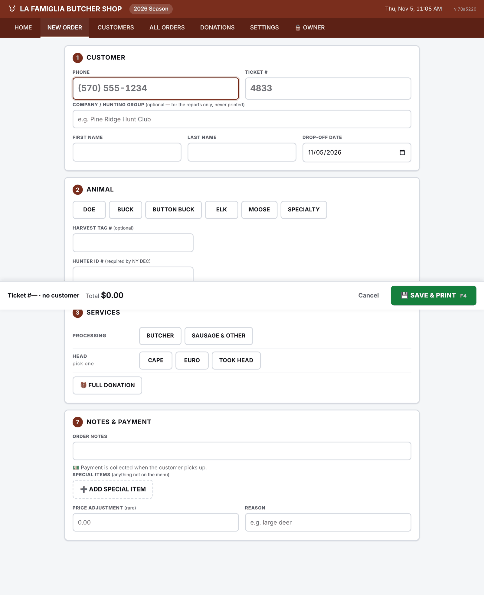

One scrolling page, not a wizard. Sections appear as they become relevant, and a sticky bar at the
bottom always shows the ticket, customer, live total and **SAVE & PRINT (F4)**.

1. **Customer** — phone first, then ticket number, an optional company / hunting group (for
   reports only, never printed), first and last name, and drop-off date (defaults to today).
2. **Animal** — Doe, Buck, Button Buck, Elk, Moose or Specialty, plus harvest tag number and Hunter
   ID number. Elk and moose ask for the weight on the bone, and specialty asks for weight and an
   optional name of the animal.
3. **Services** — Butcher and Sausage & Other, then the head as one choice: Cape, Euro or Took
   Head. Full Donation is its own button. Elk, moose and specialty animals hide the head
   choices; they are butchering only.
4. **Butcher** (when on) — backstrap Whole · 1/2 · 1/3 · 1/4 · None; steaks, roasts, stew and
   ground Basic · More · Less · None; extra cuts (Osso Bucco, Cutlets, Bone-in Chops, $40 each);
   **All Sausage** (the whole deer to sausage, no cuts); and **Donate all remaining meat**, with a
   one-tap *Usual — keep backstrap + head, donate the rest*.
5. **Sausage & Other** (when on) — three tabs: Fresh, Smoked, and Jerky & Other. Tap a flavor, pick
   the pounds. Each line shows its deer pounds, and the section totals how much meat to set aside.
6. **Euro Mount** (when on) — price (pre-filled from Settings, or blank for *To be confirmed*),
   an optional plaque, and euro notes.
7. **Notes & Payment** — order notes, **special items** (anything not on the menu, typed in with a
   price), and a rare price adjustment with a required reason. There is no payment question here;
   the form says *"Payment is collected when the customer picks up."*

### Why phone comes first

The phone field looks the customer up as digits are typed. A returning customer shows their
previous deer, their Hunter ID if one is on file, and a **⚡ REPEAT LAST ORDER** button that fills
in every selection. The repeat-customer flow collapses to:

> type phone → **REPEAT LAST ORDER** → type ticket # → **SAVE & PRINT**

If the phone belongs to someone else on file and a different name is typed, saving asks whether
it's **Fix spelling** (rename that customer on all their deer) or a **different person**. It never
guesses; guessing is how names got overwritten before October 2026.

### What makes it fast

- Phone-first entry doubles as customer lookup.
- The duplicate-ticket check runs as the number is typed, against the current season.
- Contradictory cuts are dimmed before they can be clicked (doc 4).
- The total updates live in the sticky bar.
- Warnings that need a decision ("Is this a second deer?") appear in one dialog with a single
  confirm button each.

---

## Screen 3 — ORDER (after saving, and any time later)

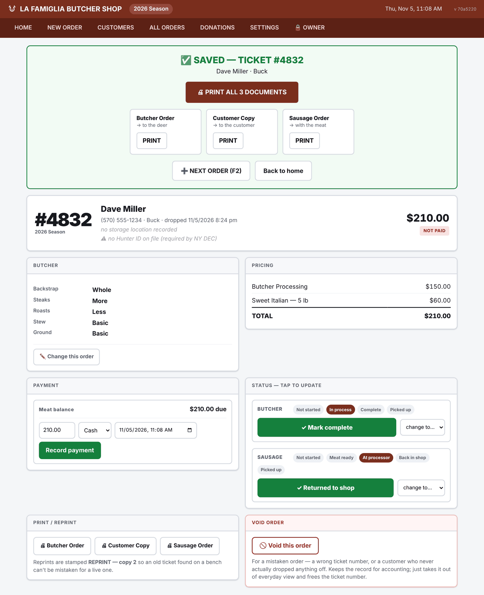

Saving opens the order with a green **SAVED** panel: **PRINT ALL N DOCUMENTS**, one card per
document saying *where the paper goes* (to the deer, to the customer, with the meat, with the
head), **NEXT ORDER (F2)**, and Back to home. Only documents that apply are shown.

The order screen itself has:

- **Header** — the ticket number as the biggest thing on the page, season, customer, animal,
  drop-off time, storage location if recorded, a warning if there's no Hunter ID, and the total
  with its payment status.
- **Butcher** and **Pricing** panels, and **✏️ Change this order** to edit. If prices have changed in Settings since the order
  was taken, saving the edit asks whether to keep the original prices or use today's (doc 4).
- **Payment** — balance due, then amount, method (cash, check, card, other) and a date and time
  that defaults to now but can be set to when the money actually changed hands. Recorded payments
  are listed and can be removed if entered by mistake. A euro mount has its own balance line.
- **Status — tap to update** — each service shows its whole path with the current step
  highlighted, one large button for the next step, and a *change to…* menu for going back or
  skipping.
- **Donation weight** (on donation orders) — a banner saying what's donated, and the package count
  with **Save weight** (doc 8).
- **Print / reprint** — any document, any time. Reprints are stamped *REPRINT — copy 2*.
- **Void order** — requires a reason, keeps the record, frees the ticket number. A voided order
  shows a banner with **Restore this order**.

**After an edit**, the screen works out which printed documents are now wrong and offers
**Reprint changed**, **Reprint all**, or **No reprint needed**, so a stale butcher ticket doesn't
stay on the deer.

The order screen works on a phone, which lets someone in the cut room look up a ticket and mark
it complete without walking to a laptop:

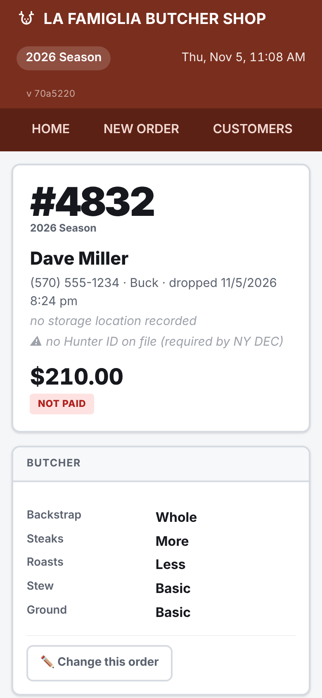

---

## Screen 4 — CUSTOMERS

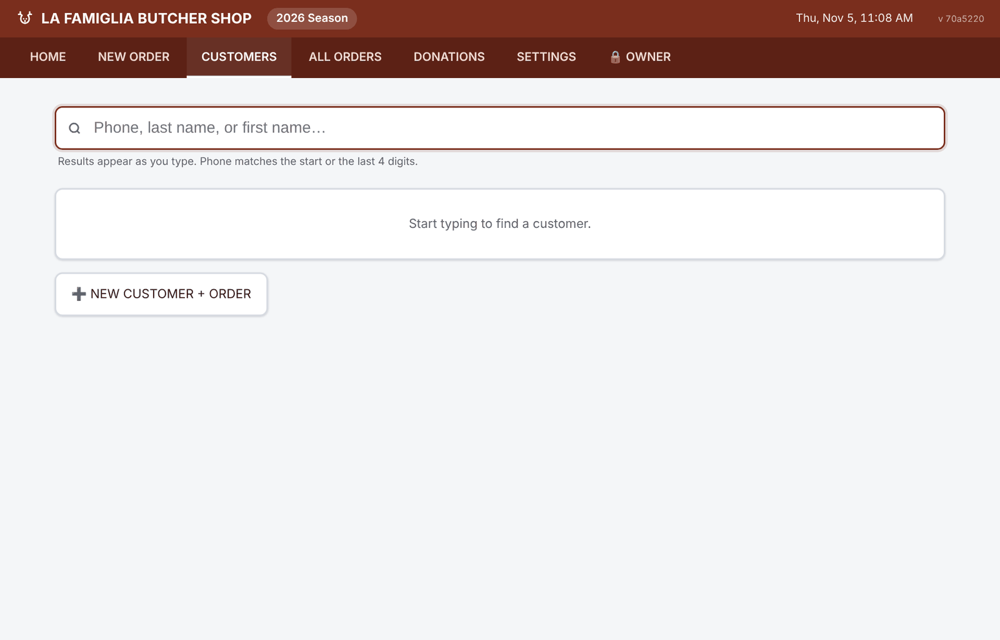

Search by phone, last name or first name; results appear as you type. Each result shows the phone
and number of deer.

## Screen 5 — CUSTOMER HISTORY

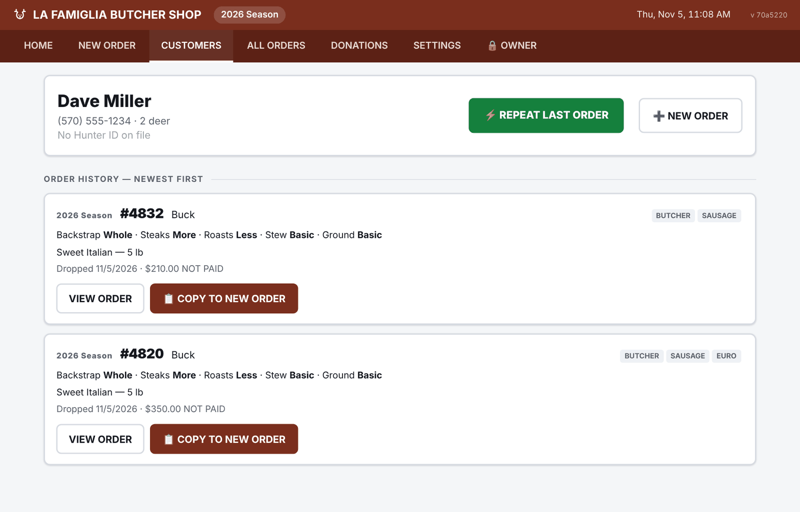

**⚡ REPEAT LAST ORDER** is the largest thing on the page. Each past order card shows the season,
ticket, animal, services, **the actual cut selections and menu lines**, and the drop-off date and
total, with **VIEW ORDER** and **📋 COPY TO NEW ORDER**. Showing the cuts on the card answers "what
did I get last year?" without opening anything.

---

## Screen 6 — ALL ORDERS

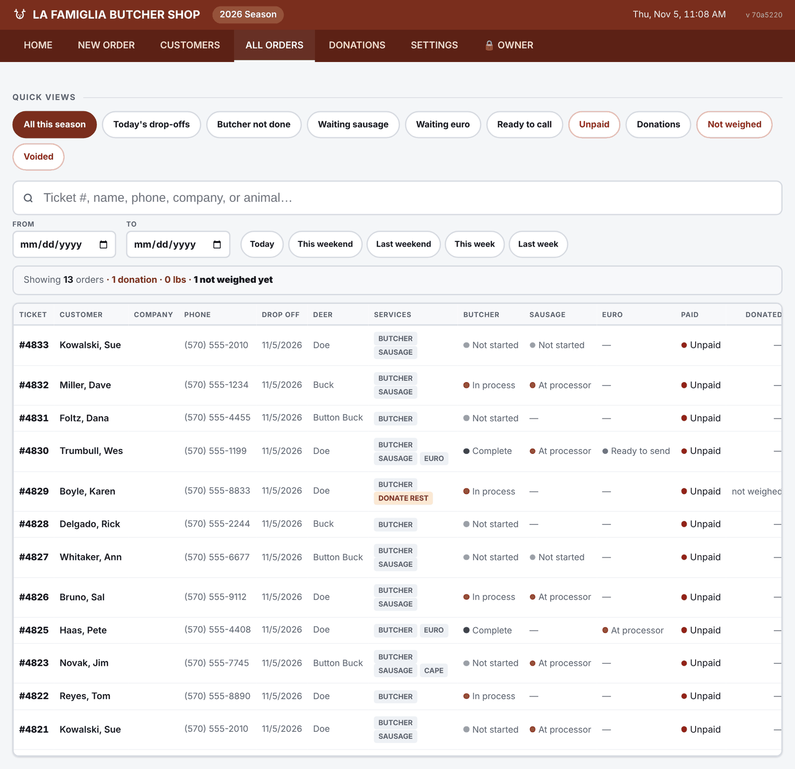

- **Quick views:** All this season (the active season only), Today's drop-offs, Butcher not done, Waiting sausage, Waiting
  euro, Ready to call, Unpaid (picked up but not paid), Donations, Not weighed, Voided.
- **Search** by ticket, name, phone, company or animal. With no quick view picked, a search looks
  across every season — ticket numbers repeat yearly — with this season first, and an order from
  another season carries a tag such as *2025 Season* next to its ticket number.
- **Date range** with Today, This weekend, Last weekend, This week and Last week shortcuts.
- **Summary line** for whatever is showing: order count, donations, donated pounds, and how many
  are not weighed yet. The dollar figures (order total, collected, still owed, donation dollars)
  appear only while the Owner area is unlocked.
- **Columns:** ticket, customer, company, phone, drop-off, animal, services, butcher, sausage and
  euro status, paid, donated $, and order total. The table scrolls inside the page so every column
  is reachable.

The list shows up to 300 orders. There's no export yet (doc 7).

---

## Screen 7 — DONATIONS

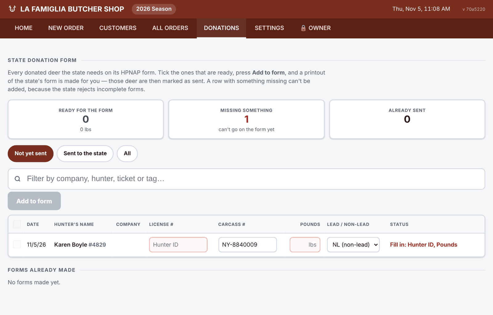

Builds the New York State HPNAP venison donation form from the orders. Each donated deer is a row
with the form's columns: date, hunter's name, company, license # (Hunter ID), carcass # (tag),
pounds, and lead or non-lead. Missing values can be typed straight into the row. A row with
anything missing can't be selected, because the state rejects incomplete forms. Tick the ready
rows, press **Add to form**, and a printable copy of the state's form is made; those deer are then
marked as sent. Forms already made are listed for reprinting, and a deer added by mistake can be
removed and sent back to the list. Details in doc 8.

---

## Screen 8 — SETTINGS

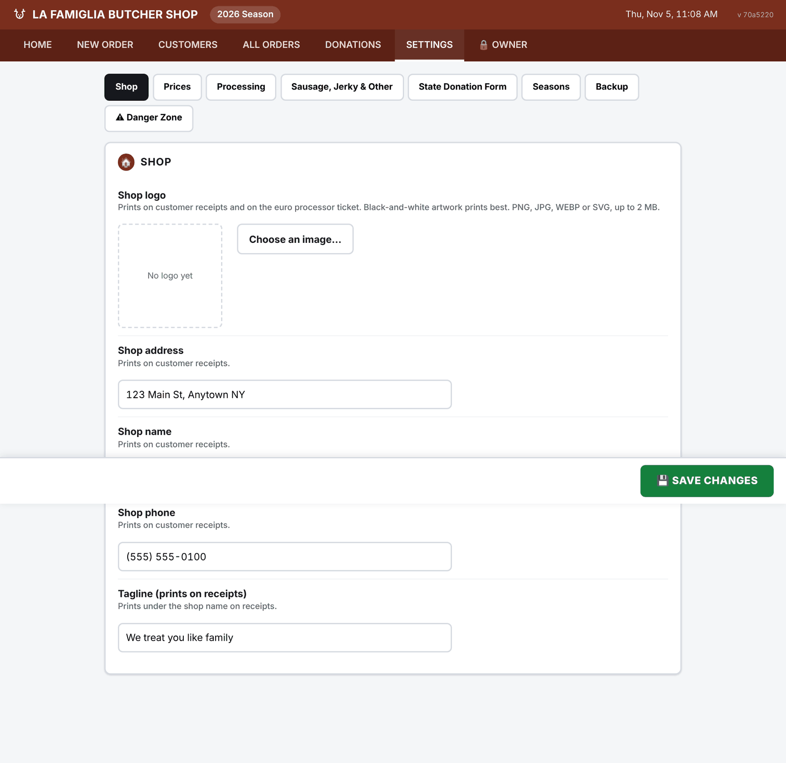

Tabs: **Shop** (logo, address, name, phone, tagline — all print on the receipt) · **Prices** ·
**Processing** (sausage ratio and minimum, donation rate, pickup hours, yield warning) ·
**Sausage, Jerky & Other** (add, rename, reorder or remove menu items; pack prices) · **State
Donation Form** (the header block printed on the form) · **Seasons** · **Backup** (destination
folder, Back up now, Restore from a backup, Recent backups) · **⚠ Danger Zone** (reset password,
Clear test data).

Every field says what it affects. Prices note that a change affects new orders. Settings converts
dollars to cents on the server, never in the browser, since this is the one screen where a UI bug
could mis-price every future order.

---

## Screen 9 — NAMES TO CHECK

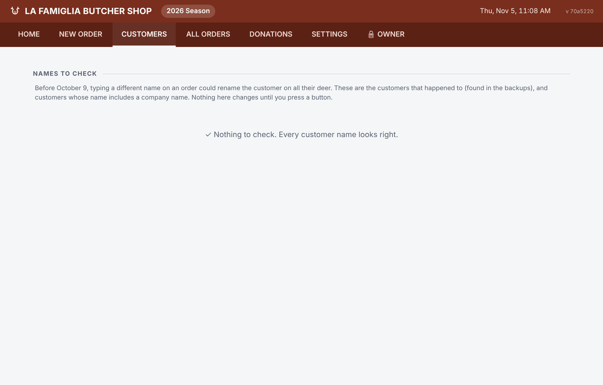

Lists customers whose name may have been overwritten before October 2026, found by reading their
names back out of the hourly backups. For each one, **✓ Name is right**, or move a deer back to the
person it was entered under, or to someone else. Reached from the Home tile.

---

## Screen 10 — 🔒 OWNER

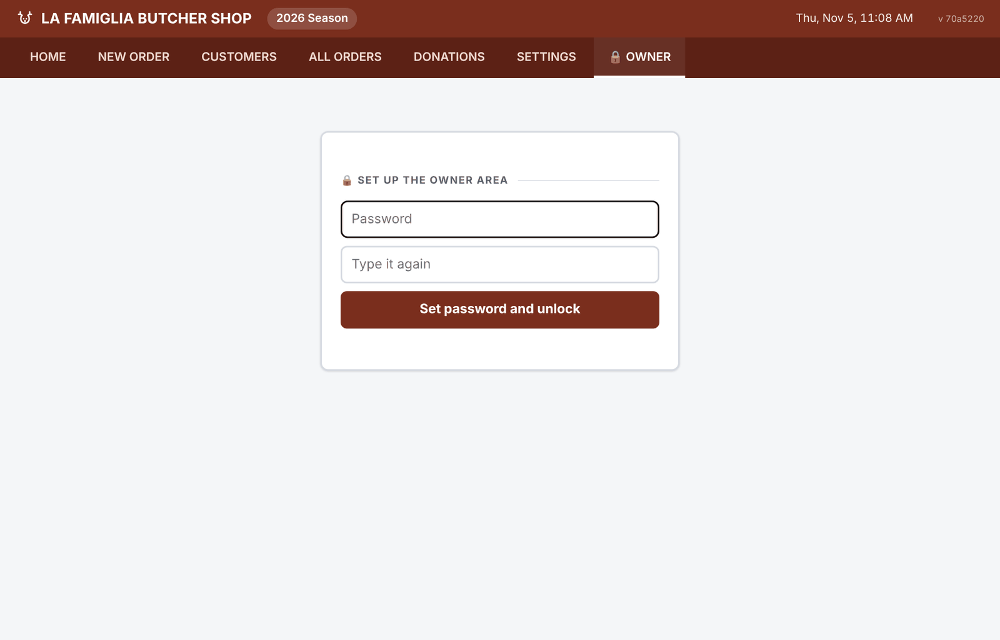

Added November 2026. The season's money is kept out of sight of employees.

- **Locked by default.** The tab shows a password box and nothing else; the numbers aren't even
  fetched until it's unlocked. The first visit sets the password. It's stored hashed in
  `owner.password`, isn't on the Settings screen, and stays with this machine when a backup is
  restored.
- **Behind it:** season totals (order total, collected, donation dollars), day / week / month
  charts with a comparison table, and *Change the owner password*. Weeks run Monday to Sunday, so
  a hunting weekend sits at the end of its week.
- **Unlocked means this window only.** A yellow bar on every screen says so, with a **Lock**
  button. It also locks after 15 minutes without use, and when the app restarts.
- **Forgotten password:** run `node scripts/clear-owner-password.js` on the shop laptop and
  restart; the next visit sets a new one.
- **Stays visible to staff:** an order's own bill, payments and the running total on New Order,
  since employees take payment at pickup.

Old `/stats` bookmarks land here.

---

## The order-entry flow, timed

### Returning customer, same order as last year

| # | Action | Elapsed |
|---|---|---|
| 1 | `F2` — new order | 0s |
| 2 | Type the phone → their previous deer appear | 8s |
| 3 | **REPEAT LAST ORDER** → every selection fills in | 10s |
| 4 | Type the ticket number | 15s |
| 5 | Glance at the sticky bar, **SAVE & PRINT** | 25s |
| 6 | **PRINT ALL**, grab the paper, `F2` | 30s |

### Brand-new customer, butcher + sausage

Phone, name, ticket, animal, services, cuts, a flavor and its pounds, save. Comfortably under two
minutes, which was the target in the requirements.
