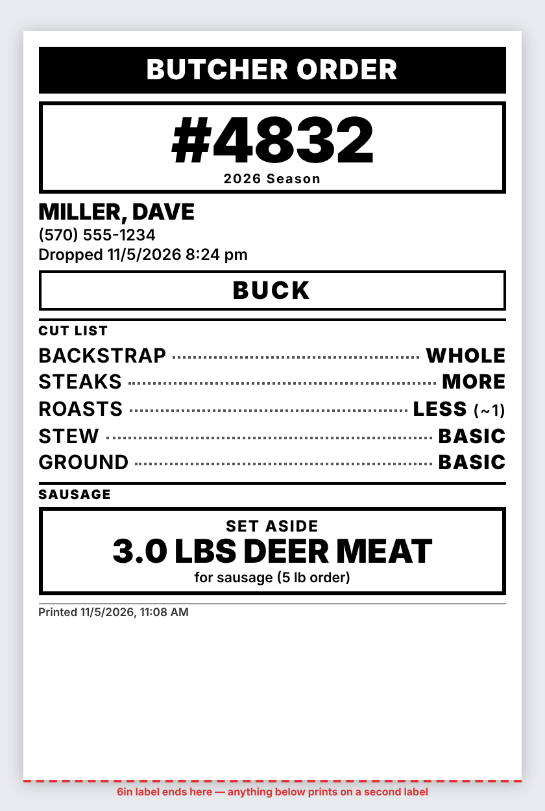
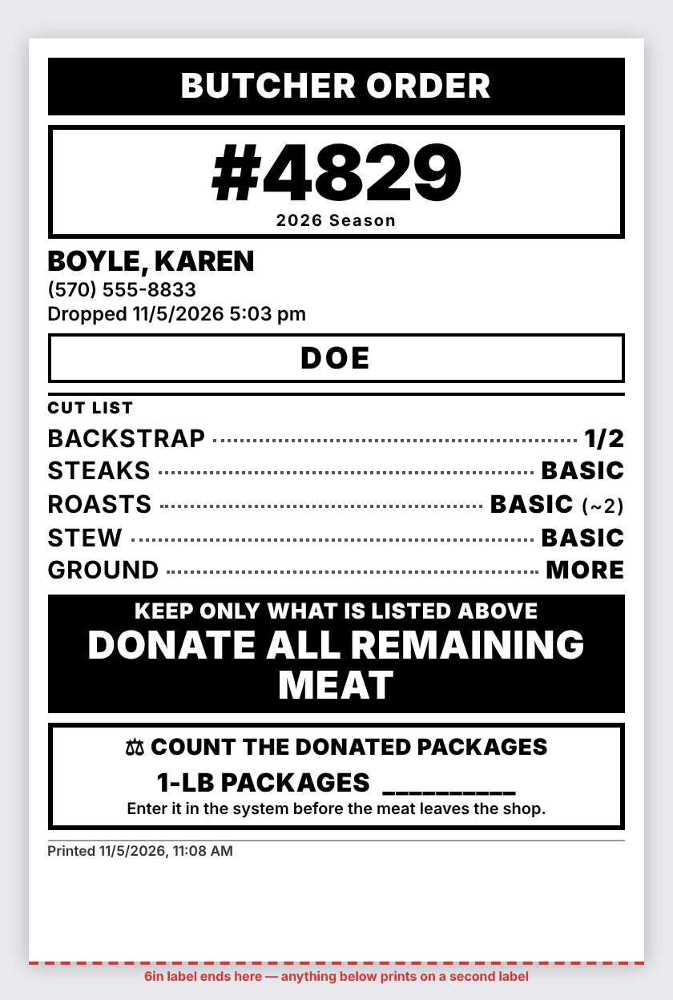
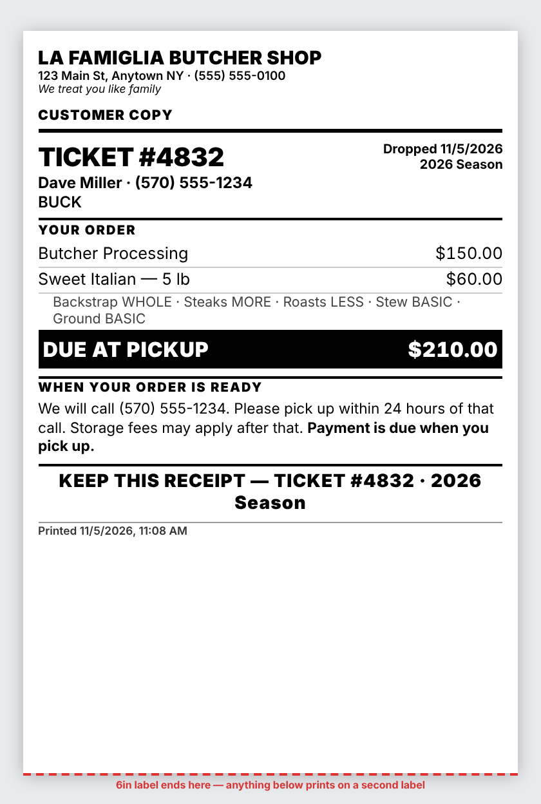
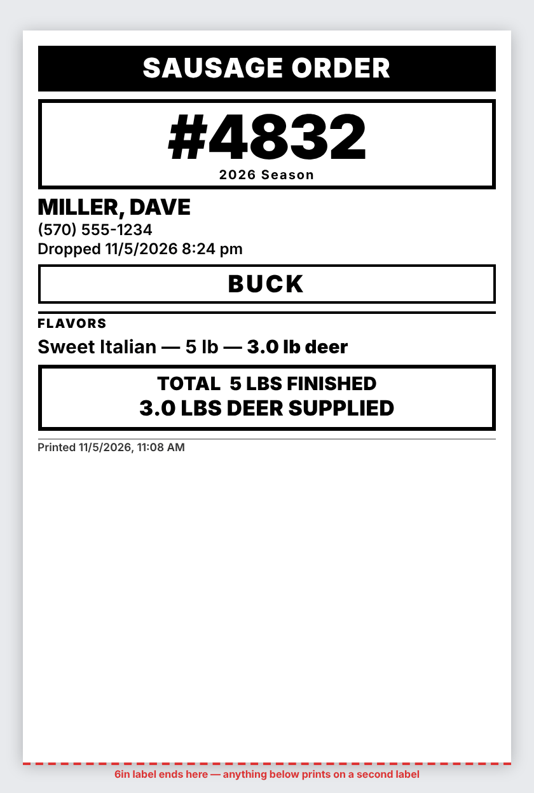
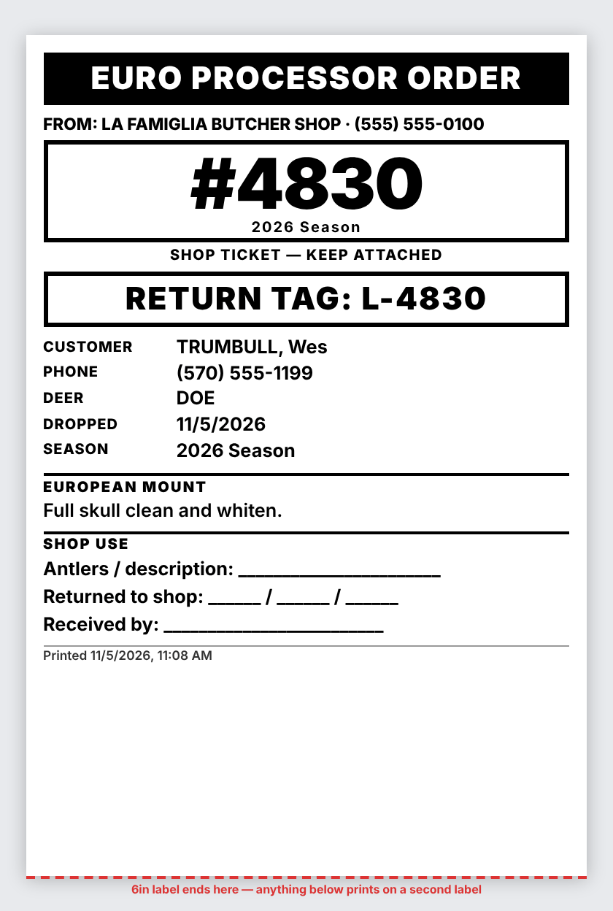

# 5. Printing Architecture & Document Layouts

*Current as of November 5, 2026. Templates are in `src/server/lib/print.js` and
`src/server/lib/donations.js`, sized by `public/print.css`. Sample printouts use demo data.*

## The core idea

**Every printable document is a URL on the server.**

```
   GET /print/order/14/butcher
   GET /print/order/14/customer
   GET /print/order/14/sausage
   GET /print/order/14/euro
   GET /print/donation-form/3          ← the state donation form
```

Each returns a complete HTML page. Adding `?auto=1` makes the page open the print dialog as soon
as it loads, and records the print in `print_jobs`. Opening a document without `?auto=1` just
shows it, and isn't counted.

This decision is what keeps the printer choice reversible:

| Stage | How the URL gets to paper | Status |
|---|---|---|
| **Today** | The browser opens it and prints through the system print dialog | Built |
| Silent printing | The server renders the same URL to PDF with headless Chromium and sends it to a named printer | **Planned** |
| Multi-printer | The same, with a document type → printer lookup | **Planned** |

The document content and layout are written once and don't change across those stages.

## Which documents print

| Document | When | Where the paper goes |
|---|---|---|
| Butcher Order | Butcher, or any donation | to the deer |
| Customer Copy | Always | to the customer |
| Sausage Order | Sausage & Other | with the meat |
| Euro Processor Order | Euro mount | with the head |

After saving, the order screen offers **PRINT ALL** plus one button per document (doc 3).
Printing never blocks saving: the order is in the database before the print buttons appear, so a
jammed printer costs a reprint, never an order. The `print.auto_print_on_save` setting is stored
but not wired up; printing is always a tap.

## The printer

The design recommended a 4" direct thermal **label** printer for the shop-side tickets and a
cheap laser for the customer copy, since thermal paper darkens with heat and the customer's
receipt might sit on a truck dashboard.

**What shipped:** Gina bought a Nelko Bluetooth 4×6 thermal shipping-label printer, and it's the
only printer in the shop, so the customer copy prints on it too. All four documents were resized
for it on August 21.

- The page is declared at the label's real size, `@page { size: 4in 6in; margin: 0 }`, because
  these are die-cut labels, not a continuous roll.
- Layouts are compressed to fit one label. Anything longer spills onto a second label rather than
  being cut off. On screen, a red dashed line marks where the 6-inch label ends.
- Thermal is ideal in coolers and poor near heat. If faded customer copies turn out to matter, the
  fix is a second plain-paper printer for that one document.

Browser printing means each laptop's print dialog is set up once for the label size. Thermal label
printers generally don't support AirPrint, which is the main argument for server-side printing
before an iPad is used for printing.

## Document layouts

### 1. Butcher Order



The four things a butcher needs while handling a carcass are the four largest things on the
label: the ticket number (with its season, since numbers repeat yearly), the customer, the cut
list, and any donation instruction.

- **Cut list** with dot leaders: backstrap, steaks, roasts (with the rough count: ~2, ~4, ~1),
  stew, ground, then extra cuts.
- **SET ASIDE N LBS DEER MEAT** — the total deer pounds for sausage, jerky and burgers, worded for
  what's on the order ("for sausage, jerky & burgers"). It says ELK or MOOSE meat on those orders.
- **ROASTS — SET ASIDE · DO NOT GRIND** — whole roasts such as Smoked Pastrami, listed on their own
  so they aren't ground with the rest.
- **SPECIAL ITEMS**, **HEAD** (cape, euro, or customer took the head) and **NOTES**.
- **All Sausage** replaces the cut list with *ALL SAUSAGE — NO CUTS*.

Donation variants:



- **Full donation** replaces the cut list with **DONATE EVERYTHING — NO MEAT RETURNED TO
  CUSTOMER**.
- **Partial donation** keeps the cut list and adds **KEEP ONLY WHAT IS LISTED ABOVE — DONATE ALL
  REMAINING MEAT**, with what the customer keeps.
- Both add a **⚖ COUNT THE DONATED PACKAGES** box with a blank for the 1-lb package count. It's on
  the butcher order because that label is in the hand of the person holding the finished meat. An
  uncounted donation is unclaimable money (doc 8).

### 2. Customer Copy



The only document with prices. Letterhead with the logo, shop name, address, phone and tagline from
Settings; ticket, customer, animal, drop-off date and season; then **YOUR ORDER**, rendered from
`order_charges`, with the cut selections in small type.

- An unpaid bill ends in **DUE AT PICKUP**. A paid one shows **PAID IN FULL — CASH** (or the method
  used); a partly paid one shows **BALANCE DUE AT PICKUP**.
- With a euro mount, the receipt shows the **TOTAL**, then **DUE AT PICKUP** for the meat and **DUE
  LATER — EURO MOUNT**, with a note that the mount is done by an outside shop and will be ready
  separately. An unpriced euro mount prints **TO BE CONFIRMED**.
- Unweighed elk, moose or specialty butchering prints *priced by weight — TO BE CONFIRMED*.
- Donation orders get a thank-you line.
- **WHEN YOUR ORDER IS READY:** we'll call this number; please pick up within 24 hours
  (`pickup.deadline_hours`); storage fees may apply; payment is due at pickup.

### 3. Sausage Order



Travels with the meat to the processor. One line per item: name, packs if any, finished pounds,
and the deer pounds supplied. Pork-only items say *PORK ONLY — NO DEER*; roasts say *ONE WHOLE
ROAST — DO NOT CHOP*. A total box shows finished pounds and deer pounds supplied, then sausage
notes.

### 4. Euro Processor Order



From the shop (logo, name, phone), the ticket block marked *SHOP TICKET — KEEP ATTACHED*, and a
**RETURN TAG** box: the first letter of the shop name and the ticket number. The processor writes it
on the skull, so matching a skull on return is reading a code rather than a judgment call. Then the
customer, phone, animal, drop-off date and season; *Full skull clean and whiten*; **PLAQUE
REQUESTED** if ordered; euro notes; and handwritten **SHOP USE** lines for antler description, date
returned and received by.

### 5. State donation form

Printed from the Donations screen as a reproduction of the New York State HPNAP venison donation
form: the header block from Settings → State Donation Form, then up to 12 rows per page with date,
hunter, license #, carcass #, pounds and lead / non-lead. Each form is saved as a snapshot, so a
reprint matches what was sent. See doc 8.

## Reprints

Any order reprints any document from its **Print / reprint** panel. A reprint writes a
`print_jobs` row with the next `copy_number` and prints **REPRINT — copy 2** in the footer. That
line keeps an old butcher ticket found on a bench from being mistaken for a live one.

After an edit, the order screen offers to reprint only the documents the edit changed (doc 3).

## Not built

- **Silent server-side printing** and **per-document printer routing.** `print_jobs.printer_target`
  exists for it; every print today is `browser`.
- **A manual size override** — a per-print "force 2 labels" toggle, or a label-size setting. Not
  built because the automatic fit has held up against real orders; it will be designed around a
  real failure if one shows up.
- **Batch numbers and two-copy euro tickets** from the original design; they depend on the batch
  shipment feature, which wasn't built (doc 7).
