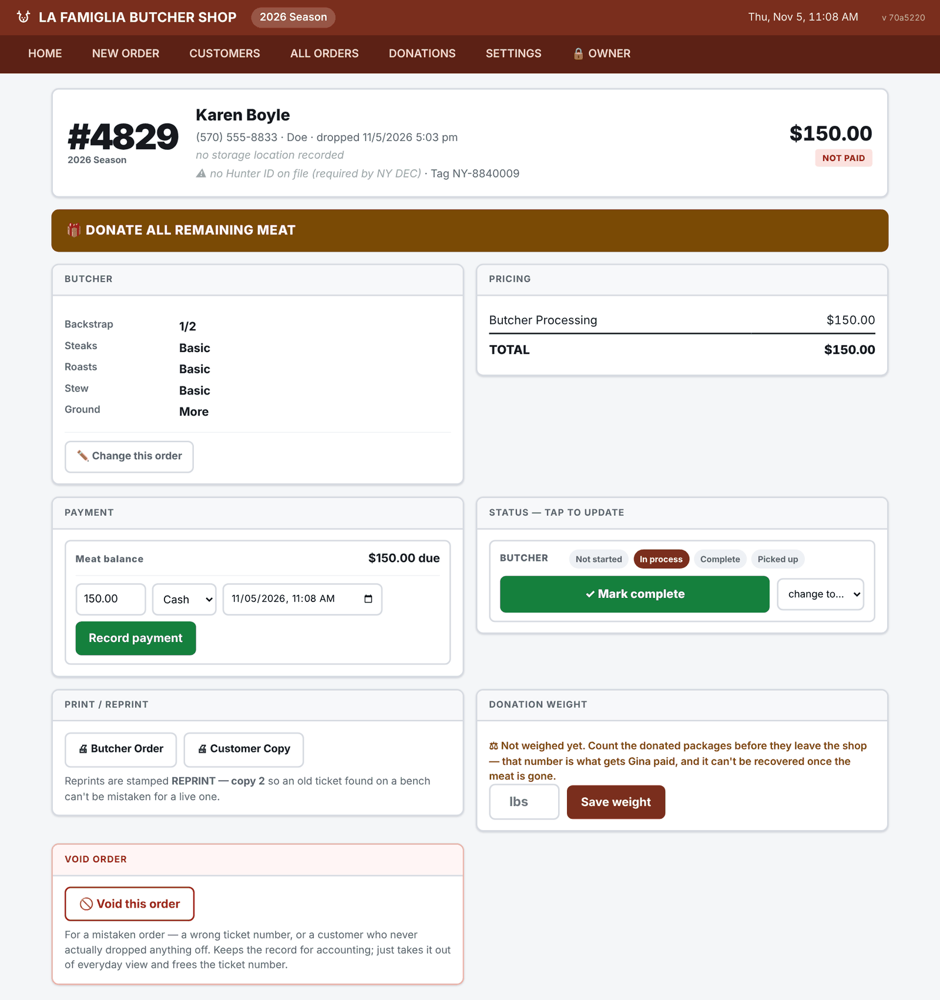
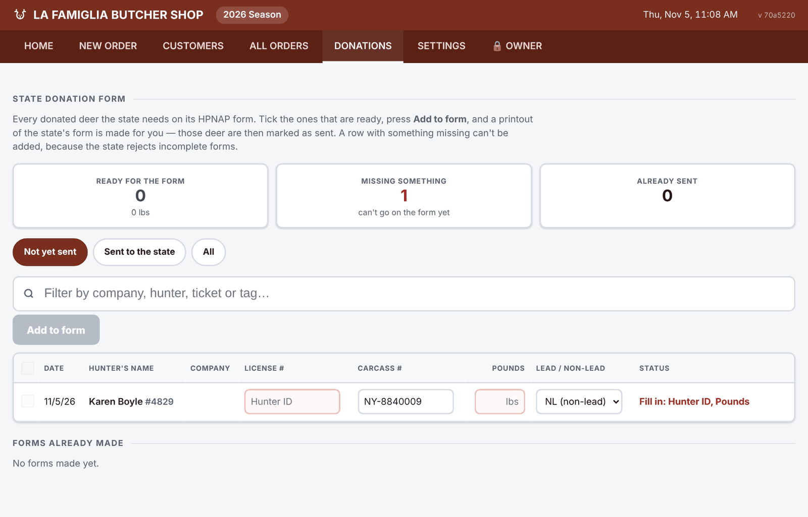

# 8. Donation Tracking

*Current as of November 5, 2026. Code: `setDonationWeight` in `src/server/lib/orders.js`, and
`src/server/lib/donations.js` for the state form.*

Donated venison goes to food banks through New York State's **HPNAP** (Hunger Prevention and
Nutrition Assistance Program) venison donation program, and the shop is reimbursed **$5.00 per
pound**, with no annual cap. The app does two things for it: captures the pound count before the
meat leaves, and fills in the state's form.

## Why the count is the one thing that can't wait

Donated meat is packed in 1-lb packages, so the weight is the package count, and the program takes
the shop's word for it. That count exists at one moment: while the packages are in front of
someone, before they go to the food bank. Once the meat is gone, the number and the claim are gone
with it.

Everything else about donations is a view over stored data and can be added later. The count can't
be.

## Donation types

| Type | On the order | Charged |
|---|---|---|
| **Full donation** | 🎁 FULL DONATION — no meat comes back; Butcher and Sausage turn off | $0, plus any head service |
| **Partial** | Butcher + *Donate all remaining meat*, with what the customer keeps ("Backstrap and head only" is one tap) | Full normal price |

Both are counted and reimbursed. A partial donation is the best-paying order in the shop: the full
processing fee plus reimbursement on the remainder.

## Capturing the count

1. **The butcher order prints a ⚖ COUNT THE DONATED PACKAGES box** with a blank for the count
   (doc 5). It's on that label because that's the paper in the hand of the person holding the meat.
2. **The order screen has a Donation weight panel** — type the pounds (the package count) and
   **Save weight**. Until then it says *Not weighed yet* in orange. The rate is snapshotted when the
   count is saved, so a later rate change never rewrites an earlier donation.

   
3. **Home shows Donations not weighed**, which should read zero, and All Orders has **Donations**
   and **Not weighed** quick views. The All Orders summary shows donated pounds and how many are
   still not weighed; the dollar value shows while the Owner area is unlocked.

| Data | |
|---|---|
| `orders.donation_type` | `none` · `full` · `remaining` |
| `orders.donated_lbs` | The package count. NULL = not counted yet. |
| `orders.donated_weighed_at` | When it was entered |
| `orders.donation_rate_cents_per_lb` | Snapshotted at entry (500) |
| `orders.donation_amount_cents` | count × rate |
| Setting `donation.rate_cents_per_lb` | 500 = $5.00/lb |

### Rules

| Level | Rule |
|---|---|
| BLOCK | The count must be a whole number of packages, greater than zero, and no more than 90 ("more than a deer usually yields — double-check"). |
| WARN | A donation with no harvest tag number: *"This deer is being donated, so the shop keeps it. Record the hunter's tag number if they have it."* |
| — | The rate is snapshotted at entry and never recalculated. |

## The state donation form *(October 2026)*

The original design deliberately left this out: the coordinator's form wasn't in hand, and the
manual process worked. Once the shop had the real form, filling it in by hand turned out to be the
recurring chore worth automating.

**DONATIONS** in the navigation (doc 3, screen 7):

- **Ready for the form / Missing something / Already sent** — counts across the top.
- One row per donated deer with the form's columns: **date, hunter's name, company, license #**
  (the Hunter ID), **carcass #** (the harvest tag), **pounds**, and **lead / non-lead**
  ammunition. Non-lead is the default, since almost every hunter uses it.
- **Missing values can be typed straight into the row**: Hunter ID, tag number, pounds.
- **A row with anything missing can't be ticked.** The state rejects incomplete forms, so an
  incomplete row is held back rather than printed and bounced. The row says what's missing:
  *Fill in: Hunter ID, Pounds.*
- **Add to form** makes a printable copy of the state's form (12 rows per page), with the header
  block from Settings → State Donation Form: business, payee, address, phone, processor, food bank
  and its contact. Those deer are tagged as sent (`state_form_id`, `state_submitted_at`).
- **Forms already made** are listed and reprint exactly as sent, from the snapshot in
  `donation_forms`.
- A deer put on a form by mistake can be removed, which sends it back to the list.
- Filters: **Not yet sent**, **Sent to the state**, **All**, plus search by company, hunter,
  ticket or tag.

A Hunter ID changed on a deer that's already on a form is not copied to the hunter's other deer
that are already sent, so the form keeps matching what the state has (doc 4).

## Still not built

| | Why | Cost to add later |
|---|---|---|
| Claim batching and payment tracking | The forms are the batches; payment is tracked outside the app | A table and a screen |
| Donation totals on Home | All Orders filtered to Donations already shows them | One line |

Every one of these is a presentation of data the app already stores. None is blocked by a
decision made now, and none gets harder to add with time.
